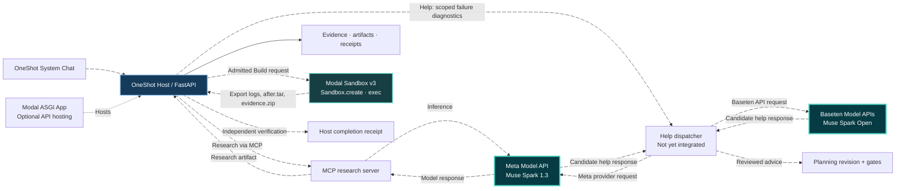

# OneShot

**From a single request to an evidence-backed software change—with the host, not the model, in control.**

OneShot separates AI research and planning from execution authority. It records what was requested, what the agents found, what may be changed, what actually ran, and what independent checks proved.

[](https://github.com/itz1508/OneShot/actions/workflows/ci.yml)
[](https://github.com/itz1508/OneShot/actions/workflows/mvp.yml)
[](https://github.com/itz1508/OneShot/actions/workflows/audit-capabilities.yml)

## Six-stage workflow and its gates

The user defines the outcome; Research records **what success looks like**, Audit Discovery inspects the repository, and Planning specifies the change. The host must admit Build before dispatching work to **Modal Sandbox**. Moving arrows illustrate the designed lifecycle; the complete workflow is **not yet connected through the MVP**.

```mermaid
flowchart TD
    ASK["User asks"] e01@--> R["1 · Research"]
    R e02@--> SUCCESS["What success looks like<br/>Accepted outcome + success criteria"]
    SUCCESS e03@--> AUDIT["2 · Audit Discovery"]
    AUDIT e04@--> PLAN["3 · Planning"]
    PLAN e05@--> CHECK{"Host gap analysis + Scanner"}
    CHECK -->|Correction required| PLAN
    CHECK e06@-->|Pass: freeze plan| FIXTURE{"4 · Fixture Validation"}
    FIXTURE -->|Fail| BLOCK["Blocked"]
    FIXTURE e07@-->|Pass| ADMIT{"Package lock + Build Admission"}
    ADMIT -->|Denied| BLOCK

    subgraph MODAL["Modal Sandbox product · standalone v3 adapter; host integration pending"]
        PREFLIGHT["Host preflight + durable checkpoint"]
        SANDBOX["Modal Sandbox.create<br/>Pinned image · network blocked"]
        TRANSFER["Modal Sandbox filesystem<br/>Upload source.tar + bundle.zip"]
        BUILD["5 · Build · sandbox.exec<br/>Apply patch + run admitted checks"]
        RETURN["Modal Sandbox export<br/>result.json · after.tar · evidence.zip"]
        PREFLIGHT e09@--> SANDBOX
        SANDBOX e10@--> TRANSFER
        TRANSFER e11@--> BUILD
        BUILD e12@--> RETURN
    end

    ADMIT e08@-->|Accepted| PREFLIGHT
    RETURN e13@-->|Download results; terminate Sandbox| RECON["Host checks exported changes + effects"]
    RECON e14@--> VERIFY{"6 · Independent Build Validation"}
    VERIFY -->|Fail| BLOCK
    VERIFY e15@-->|Pass| DONE["Build done<br/>Trusted host completion receipt"]

    BLOCK e16@--> ISOLATE["Isolate affected work<br/>Preserve checkpoints + evidence"]
    ISOLATE e17@--> ERROR["Error Handling<br/>Diagnose + reconcile"]
    ISOLATE e18@--> HELP["Call for Help<br/>Host-approved diagnostic request"]
    ERROR e19@-->|Documented correction| PLAN
    ERROR -->|Cannot resolve| HELP

    HELP e20@--> SELECT{"Select Help inference service"}
    SELECT e21@-->|Configured Meta adapter| META["Meta Model API<br/>Muse Spark 1.3"]
    SELECT e22@-->|Proposed Baseten route| BASE["Baseten Model APIs<br/>Muse Spark Open"]
    META e23@-->|Candidate diagnosis| REVIEW["Review model advice<br/>Evidence + provenance"]
    BASE e24@-->|Candidate diagnosis| REVIEW
    REVIEW e25@-->|Approved resolution| PLAN
    REVIEW -->|Unresolved| HOLD["Stay isolated<br/>Call operator for help"]

    e01@{ animation: fast }
    e02@{ animation: fast }
    e03@{ animation: fast }
    e04@{ animation: fast }
    e05@{ animation: fast }
    e06@{ animation: fast }
    e07@{ animation: fast }
    e08@{ animation: fast }
    e09@{ animation: fast }
    e10@{ animation: fast }
    e11@{ animation: fast }
    e12@{ animation: fast }
    e13@{ animation: fast }
    e14@{ animation: fast }
    e15@{ animation: slow }
    e16@{ animation: fast }
    e17@{ animation: fast }
    e18@{ animation: fast }
    e19@{ animation: fast }
    e20@{ animation: fast }
    e21@{ animation: fast }
    e22@{ animation: fast }
    e23@{ animation: fast }
    e24@{ animation: fast }
    e25@{ animation: fast }

    classDef gate fill:#473515,stroke:#efbf6d,color:#fff,stroke-width:2px;
    classDef blocked fill:#53272a,stroke:#ff9999,color:#fff,stroke-width:2px;
    classDef sandbox fill:#173e43,stroke:#5ad5c5,color:#fff,stroke-width:2px;
    classDef model fill:#073b44,stroke:#4ed3c0,color:#fff,stroke-width:2px;
    classDef success fill:#123f32,stroke:#75daa8,color:#fff,stroke-width:2px;
    class CHECK,FIXTURE,ADMIT,VERIFY,SELECT gate;
    class BLOCK,ISOLATE,ERROR,HELP,HOLD blocked;
    class SANDBOX,TRANSFER,BUILD,RETURN sandbox;
    class META,BASE model;
    class SUCCESS,DONE success;
```




**Recovery lifecycle:** A failed task or wave is isolated. The host prepares a scoped diagnostic request, then may invoke **Meta Model API** or the proposed **Baseten Model APIs** route. Model responses are **advice, not authority**. A reviewed resolution returns to **Planning**, where a new revision repeats gap checks, fixture validation, and Build Admission. Unresolved work remains isolated.

**Sandbox return lifecycle:** The standalone Modal adapter can create a disposable network-blocked Sandbox, transfer the pinned source and candidate patch, execute permitted commands, export result files, and terminate the Sandbox. OneShot host integration, independent E2E, and trusted completion receipts remain separate unfinished requirements.

[Workflow contract](.agents/contracts/workflow.yaml) · [Host controller](agent/runtime/controller.py) · [Modal Sandbox v3 source](deployment/modal/sandbox_v3/src/modal_build_sandbox/modal_runtime.py)

## Meta Muse Spark + Baseten inference + Modal products

These are **three different product responsibilities**: model inference, optional model-serving infrastructure, and isolated Build execution. Model inference is not performed inside the network-blocked Build Sandbox.




| Product | When OneShot calls it | Exact call and return | Repository status |
| --- | --- | --- | --- |
| **Meta Model API · Muse Spark 1.3** | Default model inference; candidate Help diagnosis | \`MetaProvider.generate()\` sends an OpenAI-compatible request to \`https://api.meta.ai/v1\` and receives model text | **Adapter implemented**; Help dispatch not wired |
| **Baseten Model APIs · Muse Spark Open** | Optional independent Help inference on isolated failures | OpenAI-compatible \`POST\` via \`https://inference.baseten.co/v1\`, model \`meta-models/muse-spark-open\`; returns candidate diagnosis | **Proposed**; no Baseten adapter or Help wiring |
| **Modal Sandbox · Build Sandbox v3** | Only after trusted host Build Admission | \`modal.Sandbox.create()\` → filesystem upload → \`sandbox.exec()\` → export \`result.json\`, \`after.tar\`, \`evidence.zip\` → terminate | **Standalone adapter in repo**; not connected to host MVP |
| **Modal ASGI App** | Optional FastAPI hosting | \`modal_app.py\` serves OneShot API; public Audit mode disables Research | Source present; deployment requires live verification |

**Help call contract (proposed):** Host isolates a failed work item → supplies issue ID, permitted evidence references, and redacted diagnostics → invokes a configured inference provider → validates and records its response → submits candidate findings for review → routes approved corrections to Planning. **Neither Meta nor Baseten can authorize a retry or issue a Build receipt.** No model credentials enter Modal Sandbox.

The standalone sandbox currently exposes \`modal-build-sandbox validate <request.json>\` followed, after trusted admission, by \`modal-build-sandbox execute <request.json> --app <existing-app>\`. Its outputs are only candidate Build evidence; final integration and verification remain host-owned.

[Meta provider adapter](agent/runtime/providers/meta.py) · [provider registry](agent/runtime/providers/registry.py) · [Baseten's Muse Spark Open API example](https://dev.meta.ai/docs/muse-spark-open/deploy) · [Modal Sandbox SDK](https://modal.com/docs/sdk/py/latest/Sandbox) · [Sandbox v3 README](deployment/modal/sandbox_v3/README.md)

## What exists today

| Capability | Evidence-based scope |
| --- | --- |
| **React/Vite System Chat + FastAPI MVP** | Task submission, persisted state, input revision, SSE events, and artifact inspection |
| **Research** | MCP dispatch and validated Research records when a compatible server is configured |
| **Audit** | Read-only repository inspection; distinct from the Audit Discovery workflow stage |
| **Muse Spark 1.3** | Configured Meta API adapter; live inference requires credentials and connection |
| **Modal** | Separate ASGI Audit demo and health-only deployment starter; not a running Muse model |
| **Full six-stage MVP execution** | **Not integrated end to end**: Planning, Fixture Validation, and Build have no MVP HTTP execution routes |
| **Visual demonstration** | Synthetic playback, not production execution or independent Build verification |

**The central rule:** a successful animation is not a Build receipt; an HTTP health check is not proof of MCP connectivity; deterministic browser fixtures are not proof of live Muse Spark inference.

## Run the actual application

Requires Python 3.11+, [uv](https://docs.astral.sh/uv/), Node.js, and npm.

From the repository root:

```sh
uv sync --locked --extra meta --extra mvp
uv run --no-sync python -m agent doctor
uv run --no-sync uvicorn mvp.api:app --host 127.0.0.1 --port 8000
```

In a second terminal:

```sh
cd web
npm ci
npm run dev
```

Open **http://localhost:5173**. To run actual Research, configure the MCP server transport through `ONESHOT_MCP_COMMAND` + `ONESHOT_MCP_ARGS_JSON` (stdio), or `ONESHOT_MCP_URL` (HTTP), with server-side model credentials. [Full integration instructions](mvp/README.md#research-integration).

Do not expose the local API publicly or commit credentials. Modal modes and deployment verification: [ASGI App](DEPLOYMENT.md) · [standalone health-only starter](deployment/modal/README.md).

## Verify

```sh
uv lock --check
uv run --no-sync ruff check .
uv run --no-sync ruff format --check .
uv run --no-sync mypy agent
uv run --no-sync pytest -q

cd web
npm ci
npx playwright install chromium
npm run build
npm run test:browser
npm run test:demo
```

Browser Research tests use deterministic MCP fixtures; the demo tests confirm six simulated scenarios without backend calls. Live Meta inference, authenticated Modal deployment, and connected six-stage Build acceptance each require separate runtime evidence. [CI runs](https://github.com/itz1508/OneShot/actions).

## Repository map

| Location | Purpose |
| --- | --- |
| [`.agents/contracts/workflow.yaml`](.agents/contracts/workflow.yaml) | Workflow declaration |
| [`agent/contracts/`](agent/contracts/) | Typed validation contracts |
| [`agent/runtime/`](agent/runtime/) | Host authority, persistence, receipts, recovery |
| [`agent/audit/`](agent/audit/) | Read-only repository Audit |
| [`mvp/`](mvp/) | FastAPI MVP and MCP Research |
| [`web/`](web/) | System Chat UI and browser tests |
| [`web/demo/`](web/demo/) | Synthetic playback and recording tools |
| [`deployment/modal/`](deployment/modal/) | Separate Modal deployment starter |
| [`tests/`](tests/) | Contract, workflow, security, and E2E tests |

**Canonical source:** [itz1508/OneShot on `main`](https://github.com/itz1508/OneShot). All verification claims must identify the tested revision.

## Experience OneShot

**[Animated workflow demo](web/public/demo.html)** · **[Demo guide and video capture](web/demo/README.md)** · **[Actual System Chat UI](web/)**

The animated work screen presents a role-specific robot, requirement pane, running-step timeline, handoffs, and artifact inspector. The repository contains **6 synthetic scenarios / 70 scenes** designed to show both success and failure paths:

| Scenario | Scenes | What the viewer sees |
| --- | ---: | --- |
| Complete workflow (`happy`) | 17 | Stage-by-stage progress and a simulated completed result |
| Gap correction (`gap`) | 12 | Planning corrects a discovered gap before continuing |
| Blocked execution (`blocked`) | 7 | Failed authorization prevents a Build artifact |
| Interrupted recovery (`recovery`) | 13 | Recovery and checkpoint presentation |
| MCP interaction (`mcp`) | 11 | Research tool request and result handoff |
| Repository Audit (`audit`) | 10 | Read-only inspection, evidence, and findings |

**Replay the interactive demo:**

```sh
cd web
npm ci
npm run dev
```

Open [http://localhost:5173/demo.html?scenario=happy](http://localhost:5173/demo.html?scenario=happy). Use **Scenario**, **Next Scene**, **Play/Pause**, and **Inspect Artifact**. Change the URL parameter to `gap`, `blocked`, `recovery`, `mcp`, or `audit`.

**Demo evidence boundary:** The player explicitly displays **SIMULATED · NO BACKEND**. Its events are deterministic projections; it does not call real MCP tools, invoke a model, authorize Build, or produce trusted host receipts. It illustrates the intended experience, not six-stage E2E completion.
