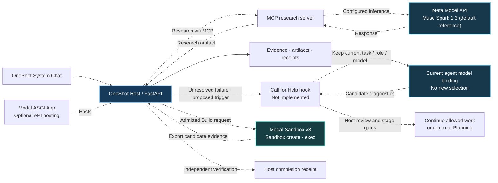

# OneShot

**From a single request to an evidence-backed software change—with the host, not the model, in control.**

OneShot separates AI research and planning from execution authority. It records what was requested, what the agents found, what may be changed, what actually ran, and what independent checks proved.

[](https://github.com/itz1508/OneShot/actions/workflows/ci.yml)
[](https://github.com/itz1508/OneShot/actions/workflows/mvp.yml)
[](https://github.com/itz1508/OneShot/actions/workflows/audit-capabilities.yml)


## Intended end-to-end workflow — detailed overview

> **Documentation-only clarification (2026-11-05):** This README edit explains the **intended workflow and user intent more clearly**. **No technical implementation, application code, workflow contracts, tests, API, configuration, runtime behavior, or execution authorization was changed.** The current source may still contain legacy Fixture Validation, Package Lock, Build Admission, and Task Integration contracts. This diagram does not claim they have been changed or removed.

**Entry operation:** User Intent → Auto-generated Summary is only an automatic, concise restatement of the request. It is not requirement analysis, Planning, approval, or execution.

**The two Audit Discovery boxes are two responsibilities of the SAME role, not two agents.** First, Audit Discovery prepares the targeted Research request and continuous fixture guidance; after Research, it performs read-only codebase discovery. Catalog provides illustrative **success-case or baseline templates**, not verified completed runs or measured baselines; it is not a workflow stage. Dashed arrows depict context and revision/follow-up routes.

```mermaid
flowchart TD
    INPUT["User Intent"] e01@--> INTENT["Auto-generated Summary<br/>Concise restatement only"]
    INTENT e02@--> SEARCH["Search Context<br/>Scope · sources · questions"]
    INTENT e03@--> REQUEST["Audit Discovery · prepare request<br/>Research questions · expected evidence<br/>Initial fixture guidance"]
    INTENT e04@-.-> CATALOG[("Catalog<br/>Success-case templates · baseline examples")]
    CATALOG e05@-.-> REQUEST
    CATALOG e06@-.-> RESEARCH
    SEARCH e07@--> RESEARCH["Researcher<br/>Generate Research To-Do · gather sources<br/>Investigate requirements · dependencies · fixtures"]
    REQUEST e08@-->|Targeted request + fixture guidance| RESEARCH
    RESEARCH e09@--> AUDIT["Audit Discovery · inspect repository<br/>Read-only source audit · trace paths and ownership<br/>Assess requirements · gaps · CodeIntent"]
    AUDIT e10@-.->|More evidence| RESEARCH
    AUDIT e11@--> PLAN["Planning<br/>Code review · design · refactor · gap analysis<br/>Scanner observations · exact file actions<br/>Dependencies · fixture-based verification"]
    PLAN e12@--> REVIEW["User Review Hook<br/>Review · Edit · Approve exact plan revision"]
    REVIEW e13@-.->|Edit or revise| PLAN
    REVIEW e14@-->|Approved plan checkpoint| BUILDER["Builder<br/>Generate and track Build Task To-Do<br/>Prepare authorized implementation candidate"]
    BUILDER e15@--> PRE["Build Preflight<br/>Check approval · paths · dependencies · preimages<br/>Tools · candidate integrity · Sandbox profile"]
    PRE e16@-->|Start Sandbox for attempt| MODAL["Modal Build Sandbox<br/>Transfer source + candidate · apply changes<br/>Execute registered checks · record effects<br/>Export results/evidence · terminate"]
    MODAL e17@--> E2E["Independent E2E Verification<br/>Run real entrypoints · integration · regression<br/>Observe user outcome against fixture guidance"]
    E2E e18@-.->|Same approved scope| BUILDER
    E2E e19@-.->|Design or scope revision| PLAN
    E2E e20@--> DONE["Completion<br/>Verified evidence · source and checkpoint<br/>Cleanup · verified reusable memory"]

    e01@{ animation: fast }
    e02@{ animation: fast }
    e03@{ animation: fast }
    e07@{ animation: fast }
    e08@{ animation: fast }
    e09@{ animation: fast }
    e11@{ animation: fast }
    e12@{ animation: fast }
    e14@{ animation: fast }
    e15@{ animation: fast }
    e16@{ animation: fast }
    e17@{ animation: fast }
    e20@{ animation: fast }
    e04@{ animation: slow }
    e05@{ animation: slow }
    e06@{ animation: slow }
    e10@{ animation: slow }
    e13@{ animation: slow }
    e18@{ animation: slow }
    e19@{ animation: slow }

    classDef intent fill:#163c4a,stroke:#29c8d5,color:#ffffff,stroke-width:2px;
    classDef role fill:#15334b,stroke:#69b9ef,color:#ffffff,stroke-width:2px;
    classDef supporting fill:#243547,stroke:#8fa1bd,color:#ffffff,stroke-width:1px;
    classDef execution fill:#163f39,stroke:#60d8b8,color:#ffffff,stroke-width:2px;
    classDef review fill:#3a3524,stroke:#ffc46b,color:#ffffff,stroke-width:2px;
    class INPUT,INTENT intent;
    class SEARCH,CATALOG supporting;
    class REQUEST,RESEARCH,AUDIT,PLAN,BUILDER role;
    class REVIEW review;
    class PRE,MODAL,E2E,DONE execution;
```



### Complete responsibility, operation, and handoff sequence

| Step and owner | Required actions | Exact handoff |
| --- | --- | --- |
| **1. User Intent / Auto-generated Summary** | Automatically summarize the user request in plain language. Do not infer requirements, add scope, decide implementation, or perform analysis at this step. | Summary → Search Context and Audit Discovery request preparation. |
| **2. Catalog — success-case / baseline templates** | Select relevant example templates for what a successful case or baseline should look like. Preserve template identity, version, and its stated success criteria or fixture blueprint where provided. Existing catalog samples are synthetic examples, **not** evidence of a completed success or a measured baseline. | Example template → Audit Discovery request preparation and Research. No extra role stage. |
| **3. Audit Discovery: initial request** | Determine what must be learned for successful discovery; define targeted research questions, required sources/evidence, unknown technical constraints, and **fixture guidance**: requirement, purpose, preconditions, triggering action, expected behavior, failure observations, required evidence, false-positive protection, setup limitations. | Research request **carrying fixture guidance** → Researcher. Guidance is created here, not executed. |
| **4. Researcher** | Read exact request, generate Research To-Do, inspect permitted sources/APIs/standards, gather requirements/dependency/fixture-related evidence, cross-check claims, preserve contradictions and unknowns, bind sources to the originating request. | Evidence-grounded Research response → Audit Discovery. |
| **5. Audit Discovery: repository inspection** | Load Research, guidance, repo instructions and source checkpoint; inspect real files, entrypoints, interfaces, schemas, dependencies, tests, dispatch, producers/consumers, ownership and paths; assess requirements, identify gaps, prepare CodeIntent, refine fixture guidance, verify source stability. Request targeted Research follow-up if needed. **Read-only; no design decisions.** | Findings + source evidence + CodeIntent + refined guidance → Planning. |
| **6. Planning** | Review code/evidence and CodeIntent; select design and refactors; perform structural gap analysis and reconcile Scanner observations; resolve paths, interfaces, dependencies, and contract gaps; specify exact create/modify/move/delete actions, expected behavior, commands, recovery and fixture-based acceptance checks. | Complete versioned Build plan and affected-file details → User Review Hook. |
| **7. User Review Hook** | Present requirements, plan, file actions, dependencies, and verification. Provide **Review / Edit / Approve**. Revision returns to Planning; approval binds to the exact plan revision and checkpoint. | Approved plan → Builder. No additional Package Lock or Build Admission stage in this intended workflow. |
| **8. Builder** | Load approved plan; **generate and track Build Task To-Do** (individual simple tasks or dependency-ordered complex work), inspect relevant source, prepare implementation changes only within approved paths, associate candidate/attempt with required checks and fixture guidance. | Authorized candidate + task identity → Build Preflight. |
| **9. Build Preflight** | Verify user approval, plan revision, source snapshot and preimages, permitted paths, task dependencies, tools/commands, candidate integrity, Sandbox profile/image/resources and attempt identity. **Start the Sandbox** after prerequisites. | Preflighted attempt → one Modal Build Sandbox. |
| **10. Modal Build Sandbox** | Provision one disposable Sandbox per Build attempt; transfer pinned source, candidate and trusted runner; prepare isolated filesystem; apply authorized changes; run specified baseline/focused/broader checks; record changed paths, command results, tree digests and effects; export artifacts; terminate. | result.json + after.tar + evidence.zip + attempt state → independent E2E. No separate Task Integration stage in the intended workflow. |
| **11. Independent E2E Verification** | Inspect resulting source and Build To-Do; execute real application entrypoints, integration, regression and required edge cases; compare observed behavior to accepted user requirements and carried fixture guidance; retain evidence. Correct same-scope work via Builder and Preflight; changed scope goes via Planning and user review. | Evidence-backed observed user outcome → Completion. |
| **12. Completion / retention** | Preserve source identity, completed task evidence, independent verification results and final checkpoint; reconcile outstanding attempts; clean temporary work and Sandboxes; retain trusted artifacts and promote only verified reusable knowledge. | Completion record and eligible memory. |

### Fixture guidance persists through every responsibility

**Audit Discovery request → Research evidence → Audit Discovery repository inspection → Planning verification design → User-reviewed plan → Builder To-Do → Build Preflight → Modal Sandbox checks → independent E2E observations.**

Each handoff preserves its fixture ID, originating requirement, guidance revision, expected observation, and evidence references. Research investigates the guidance, Audit Discovery refines it against actual code, Planning binds it to concrete actions and acceptance criteria, Builder carries it with tasks, Sandbox executes applicable checks, and E2E independently observes product behavior. Guidance is **not** a standalone Fixture Validation stage, a second Sandbox, or proof that tests have run.

### Checkpoints, corrections, and boundaries

- **User approval checkpoint:** Exact plan revision, approved path scope, requirements, guidance, and decision. An edited plan requires renewed review; a completed To-Do does not authorize new scope.
- **Research follow-ups:** Audit Discovery can ask for missing evidence and resume its existing work context. Do not add another agent or restart the full workflow.
- **Build correction:** A correction inside approved scope returns to Builder → Preflight → a **new disposable Sandbox attempt**. A change to architecture, files, dependencies or requirements returns to Planning → User Review.
- **Evidence and recovery:** Preserve command output, attempted effects, revisions, source digests, evidence references and checkpoints. Reconcile uncertain effects before continuation. Sandbox output alone is not a verified user outcome.
- **Supporting services:** Catalog, tool/provider registries, artifact/event stores, checkpoints, work tracking, receipts and memory support the sequence, but are not separate user-facing stages.
- **Evidence boundary:** Animated edges show the intended narrative, **not observed runtime execution**. Source contracts, runtime implementation, and real connected E2E results must be verified separately. This README edit does not modify any of them.

[Existing workflow contract](.agents/contracts/workflow.yaml) · [Role instructions](.agents/reference/) · [Standalone Modal Sandbox](deployment/modal/sandbox_v3/README.md)

## Model metadata, Help hook, and Modal product boundaries

The model name and API endpoint are **informational runtime/configuration metadata, not interactive workflow choices**. An individual Build or Call for Help must never silently switch to another model. Model provider setup is a separate operator configuration surface, not a decision inside a task.



| Product / configuration | Information shown | Actual status |
| --- | --- | --- |
| **Meta Model API · Muse Spark 1.3** | Default adapter model `muse-spark-1.3` and default endpoint `https://api.meta.ai/v1`; environment overrides may apply | Meta adapter exists; stage-level Help hook is **not implemented** |
| **Baseten Model APIs · Muse Spark Open** | External inference-service reference only; it is **not** a selectable Help fallback | No Baseten Help adapter or failover in this repository |
| **Modal Sandbox v3** | Build execution service separate from inference | Standalone implementation exists; integrated full host E2E remains unverified |
| **Modal ASGI App** | Optional FastAPI hosting; separate from model choice | Source exists; deployment must be verified |

**Call for Help contract (proposed, not implemented):** Preserve task/run identity, the interrupted role, and the model/provider already bound to that role. The host issues a scoped diagnostic hook with an error ID and permitted redacted evidence, then validates the resulting advice. **No provider picker, model substitution, independent Help agent, new workflow stage, or automatic retry authorization.** The model continues with its existing identity only after host recovery and admission checks. When an input or Plan changes, the authorized owner must create a revision and rerun its gates.

**Display contract:** The UI may show the configured model ID, endpoint, and observed connector status as read-only metadata. Those values do not prove a model was used for a particular stage; a true per-run model label requires a trusted dispatch/event binding. Operator connection configuration remains separate from the presentation.

The standalone sandbox currently exposes `modal-build-sandbox validate <request.json>` followed, after trusted admission, by `modal-build-sandbox execute <request.json> --app <existing-app>`. Its outputs are only candidate Build evidence; final integration and verification remain host-owned.

[Meta provider adapter](agent/runtime/providers/meta.py) · [provider registry](agent/runtime/providers/registry.py) · [Modal Sandbox SDK](https://modal.com/docs/sdk/py/latest/Sandbox) · [Sandbox v3 README](deployment/modal/sandbox_v3/README.md)

## What exists today

| Capability | Evidence-based scope |
| --- | --- |
| **React/Vite System Chat + FastAPI MVP** | Task submission, persisted state, input revision, SSE events, and artifact inspection |
| **Research** | MCP dispatch and validated Research records when a compatible server is configured |
| **Audit** | Read-only repository inspection; distinct from the Audit Discovery workflow stage |
| **Muse Spark 1.3** | Configured Meta API adapter; live inference requires credentials and connection |
| **Modal** | Separate ASGI Audit demo and health-only deployment starter; not a running Muse model |
| **Full six-stage MVP execution** | **Not integrated end to end**: Planning, Fixture Validation, and Build have no MVP HTTP execution routes |
| **Visual demonstration** | Synthetic playback, not production execution or independent Build verification |

**The central rule:** a successful animation is not a Build receipt; an HTTP health check is not proof of MCP connectivity; deterministic browser fixtures are not proof of live Muse Spark inference.

## Run the actual application

Requires Python 3.11+, [uv](https://docs.astral.sh/uv/), Node.js, and npm.

From the repository root:

```sh
uv sync --locked --extra meta --extra mvp
uv run --no-sync python -m agent doctor
uv run --no-sync uvicorn mvp.api:app --host 127.0.0.1 --port 8000
```

In a second terminal:

```sh
cd web
npm ci
npm run dev
```

Open **http://localhost:5173**. To run actual Research, configure the MCP server transport through `ONESHOT_MCP_COMMAND` + `ONESHOT_MCP_ARGS_JSON` (stdio), or `ONESHOT_MCP_URL` (HTTP), with server-side model credentials. [Full integration instructions](mvp/README.md#research-integration).

Do not expose the local API publicly or commit credentials. Modal modes and deployment verification: [ASGI App](DEPLOYMENT.md) · [standalone health-only starter](deployment/modal/README.md).

## Verify

```sh
uv lock --check
uv run --no-sync ruff check .
uv run --no-sync ruff format --check .
uv run --no-sync mypy agent
uv run --no-sync pytest -q

cd web
npm ci
npx playwright install chromium
npm run build
npm run test:browser
npm run test:demo
```

Browser Research tests use deterministic MCP fixtures; the demo tests confirm six simulated scenarios without backend calls. Live Meta inference, authenticated Modal deployment, and connected six-stage Build acceptance each require separate runtime evidence. [CI runs](https://github.com/itz1508/OneShot/actions).

## Repository map

| Location | Purpose |
| --- | --- |
| [`.agents/contracts/workflow.yaml`](.agents/contracts/workflow.yaml) | Workflow declaration |
| [`agent/contracts/`](agent/contracts/) | Typed validation contracts |
| [`agent/runtime/`](agent/runtime/) | Host authority, persistence, receipts, recovery |
| [`agent/audit/`](agent/audit/) | Read-only repository Audit |
| [`mvp/`](mvp/) | FastAPI MVP and MCP Research |
| [`web/`](web/) | System Chat UI and browser tests |
| [`web/demo/`](web/demo/) | Synthetic playback and recording tools |
| [`deployment/modal/`](deployment/modal/) | Separate Modal deployment starter |
| [`tests/`](tests/) | Contract, workflow, security, and E2E tests |

**Canonical source:** [itz1508/OneShot on `main`](https://github.com/itz1508/OneShot). All verification claims must identify the tested revision.

## Experience OneShot

**[Animated workflow demo](web/public/demo.html)** · **[Demo guide and video capture](web/demo/README.md)** · **[Actual System Chat UI](web/)**

The animated work screen presents a role-specific robot, requirement pane, running-step timeline, handoffs, and artifact inspector. The repository contains **6 synthetic scenarios / 70 scenes** designed to show both success and failure paths:

| Scenario | Scenes | What the viewer sees |
| --- | ---: | --- |
| Complete workflow (`happy`) | 17 | Stage-by-stage progress and a simulated completed result |
| Gap correction (`gap`) | 12 | Planning corrects a discovered gap before continuing |
| Blocked execution (`blocked`) | 7 | Failed authorization prevents a Build artifact |
| Interrupted recovery (`recovery`) | 13 | Recovery and checkpoint presentation |
| MCP interaction (`mcp`) | 11 | Research tool request and result handoff |
| Repository Audit (`audit`) | 10 | Read-only inspection, evidence, and findings |

**Replay the interactive demo:**

```sh
cd web
npm ci
npm run dev
```

Open [http://localhost:5173/demo.html?scenario=happy](http://localhost:5173/demo.html?scenario=happy). Use **Scenario**, **Next Scene**, **Play/Pause**, and **Inspect Artifact**. Change the URL parameter to `gap`, `blocked`, `recovery`, `mcp`, or `audit`.

**Demo evidence boundary:** The player explicitly displays **SIMULATED · NO BACKEND**. Its events are deterministic projections; it does not call real MCP tools, invoke a model, authorize Build, or produce trusted host receipts. It illustrates the intended experience, not six-stage E2E completion.
