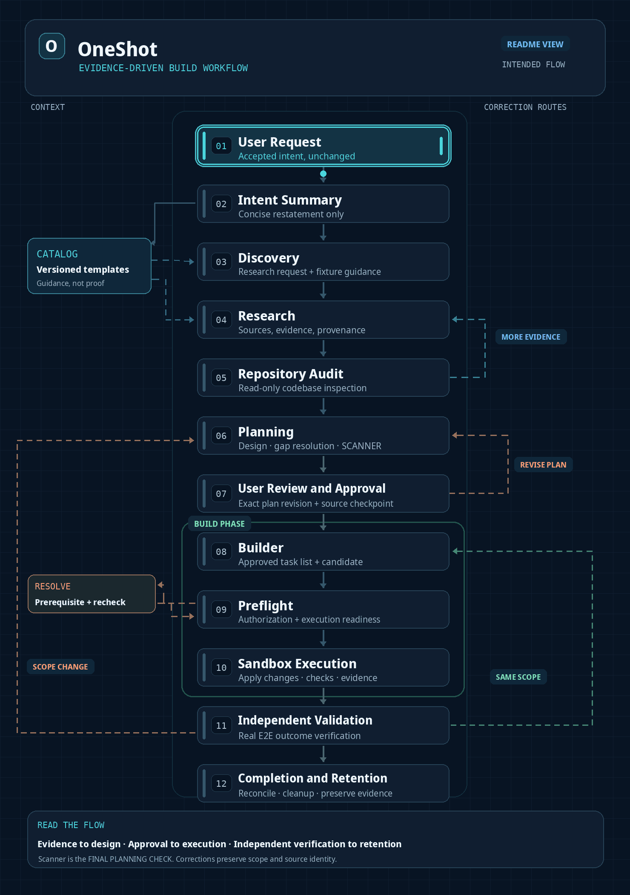

# OneShot

**From a single request to an evidence-backed software change—with the host, not the model, in control.**

OneShot separates AI research and planning from execution authority. It records what was requested, what the agents found, what may be changed, what actually ran, and what independent checks proved.

[](https://github.com/itz1508/OneShot/actions/workflows/ci.yml)
[](https://github.com/itz1508/OneShot/actions/workflows/mvp.yml)
[](https://github.com/itz1508/OneShot/actions/workflows/audit-capabilities.yml)


## Intended end-to-end workflow

> **Documentation status (2026-11-05):** This diagram describes the intended workflow, not confirmed runtime behavior. It does not alter application code, workflow contracts, authorization, or tests.

[](docs/workflow.gif)

*Open the animation for a full-size view. The main flow runs top to bottom; Catalog and Scanner support it from the sides.*

The central vertical path shows the ordered workflow. Catalog guidance and correction routes branch horizontally. **The host controls routing, state, approval enforcement, execution authorization, and evidence retention.** The animation is an architectural explanation, not a recording of a successful run.

### Overview

**User Request → Automatic Summary → Discovery Request → Research → Repository Audit → Planning → User Review → Builder → Preflight → Sandbox Execution → Independent Validation → Completion.**

Catalog supplies versioned example templates to **both** Discovery request preparation and Research. Templates illustrate expected behavior; they are not proof of a successful implementation or measured baselines.

### Core rules

- The automatic summary preserves user intent without adding requirements or selecting implementation details.
- Discovery request preparation defines research questions, required evidence, constraints, and fixture guidance.
- Research returns evidence with provenance, contradictions, and unresolved questions. Repository Audit inspects that evidence against actual source.
- Repository Audit is read-only; Planning owns architecture, design, refactoring decisions, and exact file actions.
- User approval binds to **one plan revision and source checkpoint**. Changes to the plan require renewed approval.
- Builder operates only within the approved scope. **Preflight must complete before** any Sandbox execution; unresolved prerequisites block execution.
- One disposable Modal Sandbox is used per execution attempt. Its results are evidence inputs, not self-certified completion.
- Independent Validation observes actual behavior against accepted requirements, including integration, regression, and recovery checks where applicable.
- Completion requires reconciled attempts, trusted verification evidence, the recorded source checkpoint, cleanup, and retained artifacts.

### Workflow stages and handoffs

| Stage | Responsibility | Handoff |
| --- | --- | --- |
| Automatic Summary | Restate the request faithfully, without requirement analysis | Request summary to Catalog and Discovery |
| Catalog Selection | Select applicable versioned success-case or baseline examples | Template references to Discovery **and** Research |
| Discovery Request Preparation | Formulate targeted research questions and initial fixture guidance | Research request and guidance |
| Research | Gather evidence, track sources, contradictions, and unknowns | Evidence-grounded research response to Audit |
| Repository Audit | Read repository files, contracts, dependencies, paths, tests, and ownership; refine fixture guidance | Read-only findings and CodeIntent to Planning |
| Planning | Review evidence, resolve design and gaps, specify file actions, dependencies, checks, and acceptance criteria | Versioned plan for user review |
| User Review & Approval | Review or edit the plan; approve the exact revision and source checkpoint | Approval record bound to that revision/checkpoint |
| Builder | Create and track Build Task To-Do; prepare authorized changes only | Candidate and task metadata to Preflight |
| Build Preflight | Check approval, source preimages, paths, dependencies, commands, tools, and Sandbox profile | Authorized execution attempt or recorded blocker |
| Sandbox Execution | Apply the candidate in an isolated environment, run registered checks, record effects, and export evidence | Execution artifacts and attempt state |
| Independent Validation | Run real entrypoints and required integration, regression, and edge-case checks against accepted criteria | Evidence-backed verification results |
| Completion & Retention | Reconcile attempts, preserve final source identity, clean up temporary resources, and retain trusted evidence | Completion record and eligible reusable knowledge |

**Discovery responsibility:** Request preparation and repository inspection are two operations of the *same Audit Discovery role*, separated by Research, not two independent agents. Fixture guidance follows the task from request preparation through independent validation; guidance itself is not a completed test.

### Artifact contracts

Every handoff must identify its **producer, consumer, schema version, originating request, and applicable source or plan revision**. A contract defines required fields, source/evidence references, preconditions, status semantics, consumer expectations, and retention.

Do not create multiple output files for one logical result unless they have different schemas and responsibilities. Canonical artifact names beyond the Sandbox exports must be confirmed against registered contracts before being described as implemented.

**Sandbox attempt exports:**

- `result.json` — structured command and execution results
- `after.tar` — resulting source tree
- `evidence.zip` — recorded execution evidence
- **Attempt state** — lifecycle, interruption/recovery, and reconciliation status

These exports support independent verification; they do not replace it.

### Approval and correction paths

| Condition | Required route |
| --- | --- |
| Audit needs additional evidence | Audit → targeted Research follow-up → Audit |
| User requests a plan change | User Review → Planning → User Review |
| Plan revision or source checkpoint changes | Reconcile the change and obtain fresh review/approval before implementation |
| Preflight prerequisites are unresolved | Resolve prerequisites → rerun Preflight; **do not start Sandbox** |
| Validation identifies a defect within approved scope | Builder → Preflight → new Sandbox attempt → Independent Validation |
| Validation requires new design, files, dependencies, or requirements | Planning → User Review → Builder → Preflight → Sandbox → Independent Validation |
| Execution is interrupted or effects are uncertain | Preserve attempt evidence, reconcile side effects, and establish safe retry disposition before continuing |

### Completion criteria

Completion requires evidence-backed verification of accepted user outcomes; an accounted-for Build Task To-Do and required checks; recorded source identity and final checkpoint; reconciled attempts; cleaned temporary work and Sandboxes; retained trusted artifacts; and promotion of reusable knowledge **only from verified results**.

### Implementation status and authority

**Intended design, not verified implementation.** The current [workflow contract](.agents/contracts/workflow.yaml) still declares legacy Fixture Validation, Package Lock, Build Admission, Task Integration, and Build Validation operations. Their presence in the source is not evidence that they were removed or replaced. The GIF and README do not establish connected end-to-end execution.

[Role instructions](.agents/reference/) · [Standalone Modal Sandbox](deployment/modal/sandbox_v3/README.md)


## Model metadata, Help hook, and Modal product boundaries

The model name and API endpoint are **informational runtime/configuration metadata, not interactive workflow choices**. An individual Build or Call for Help must never silently switch to another model. Model provider setup is a separate operator configuration surface, not a decision inside a task.


| Product / configuration | Information shown | Actual status |
| --- | --- | --- |
| **Meta Model API · Muse Spark 1.3** | Default adapter model `muse-spark-1.3` and default endpoint `https://api.meta.ai/v1`; environment overrides may apply | Meta adapter exists; stage-level Help hook is **not implemented** |
| **Baseten Model APIs · Muse Spark Open** | External inference-service reference only; it is **not** a selectable Help fallback | No Baseten Help adapter or failover in this repository |
| **Modal Sandbox v3** | Build execution service separate from inference | Standalone implementation exists; integrated full host E2E remains unverified |
| **Modal ASGI App** | Optional FastAPI hosting; separate from model choice | Source exists; deployment must be verified |

**Call for Help contract (proposed, not implemented):** Preserve task/run identity, the interrupted role, and the model/provider already bound to that role. The host issues a scoped diagnostic hook with an error ID and permitted redacted evidence, then validates the resulting advice. **No provider picker, model substitution, independent Help agent, new workflow stage, or automatic retry authorization.** The model continues with its existing identity only after host recovery and admission checks. When an input or Plan changes, the authorized owner must create a revision and rerun its gates.

**Display contract:** The UI may show the configured model ID, endpoint, and observed connector status as read-only metadata. Those values do not prove a model was used for a particular stage; a true per-run model label requires a trusted dispatch/event binding. Operator connection configuration remains separate from the presentation.

The standalone sandbox currently exposes `modal-build-sandbox validate <request.json>` followed, after trusted admission, by `modal-build-sandbox execute <request.json> --app <existing-app>`. Its outputs are only candidate Build evidence; final integration and verification remain host-owned.

[Meta provider adapter](agent/runtime/providers/meta.py) · [provider registry](agent/runtime/providers/registry.py) · [Modal Sandbox SDK](https://modal.com/docs/sdk/py/latest/Sandbox) · [Sandbox v3 README](deployment/modal/sandbox_v3/README.md)

## What exists today

| Capability | Evidence-based scope |
| --- | --- |
| **React/Vite System Chat + FastAPI MVP** | Task submission, persisted state, input revision, SSE events, and artifact inspection |
| **Research** | MCP dispatch and validated Research records when a compatible server is configured |
| **Audit** | Read-only repository inspection; distinct from the Audit Discovery workflow stage |
| **Muse Spark 1.3** | Configured Meta API adapter; live inference requires credentials and connection |
| **Modal** | Separate ASGI Audit demo and health-only deployment starter; not a running Muse model |
| **Full six-stage MVP execution** | **Not integrated end to end**: Planning, Fixture Validation, and Build have no MVP HTTP execution routes |
| **Visual demonstration** | Synthetic playback, not production execution or independent Build verification |

**The central rule:** a successful animation is not a Build receipt; an HTTP health check is not proof of MCP connectivity; deterministic browser fixtures are not proof of live Muse Spark inference.

## Run the actual application

Requires Python 3.11+, [uv](https://docs.astral.sh/uv/), Node.js, and npm.

From the repository root:

```sh
uv sync --locked --extra meta --extra mvp
uv run --no-sync python -m agent doctor
uv run --no-sync uvicorn mvp.api:app --host 127.0.0.1 --port 8000
```

In a second terminal:

```sh
cd web
npm ci
npm run dev
```

Open **http://localhost:5173**. To run actual Research, configure the MCP server transport through `ONESHOT_MCP_COMMAND` + `ONESHOT_MCP_ARGS_JSON` (stdio), or `ONESHOT_MCP_URL` (HTTP), with server-side model credentials. [Full integration instructions](mvp/README.md#research-integration).

Do not expose the local API publicly or commit credentials. Modal modes and deployment verification: [ASGI App](DEPLOYMENT.md) · [standalone health-only starter](deployment/modal/README.md).

## Verify

```sh
uv lock --check
uv run --no-sync ruff check .
uv run --no-sync ruff format --check .
uv run --no-sync mypy agent
uv run --no-sync pytest -q

cd web
npm ci
npx playwright install chromium
npm run build
npm run test:browser
npm run test:demo
```

Browser Research tests use deterministic MCP fixtures; the demo tests confirm six simulated scenarios without backend calls. Live Meta inference, authenticated Modal deployment, and connected six-stage Build acceptance each require separate runtime evidence. [CI runs](https://github.com/itz1508/OneShot/actions).

## Repository map

| Location | Purpose |
| --- | --- |
| [`.agents/contracts/workflow.yaml`](.agents/contracts/workflow.yaml) | Workflow declaration |
| [`agent/contracts/`](agent/contracts/) | Typed validation contracts |
| [`agent/runtime/`](agent/runtime/) | Host authority, persistence, receipts, recovery |
| [`agent/audit/`](agent/audit/) | Read-only repository Audit |
| [`mvp/`](mvp/) | FastAPI MVP and MCP Research |
| [`web/`](web/) | System Chat UI and browser tests |
| [`web/demo/`](web/demo/) | Synthetic playback and recording tools |
| [`deployment/modal/`](deployment/modal/) | Separate Modal deployment starter |
| [`tests/`](tests/) | Contract, workflow, security, and E2E tests |

**Canonical source:** [itz1508/OneShot on `main`](https://github.com/itz1508/OneShot). All verification claims must identify the tested revision.

## Experience OneShot

**[Animated workflow demo](web/public/demo.html)** · **[Demo guide and video capture](web/demo/README.md)** · **[Actual System Chat UI](web/)**

The animated work screen presents a role-specific robot, requirement pane, running-step timeline, handoffs, and artifact inspector. The repository contains **6 synthetic scenarios / 70 scenes** designed to show both success and failure paths:

| Scenario | Scenes | What the viewer sees |
| --- | ---: | --- |
| Complete workflow (`happy`) | 17 | Stage-by-stage progress and a simulated completed result |
| Gap correction (`gap`) | 12 | Planning corrects a discovered gap before continuing |
| Blocked execution (`blocked`) | 7 | Failed authorization prevents a Build artifact |
| Interrupted recovery (`recovery`) | 13 | Recovery and checkpoint presentation |
| MCP interaction (`mcp`) | 11 | Research tool request and result handoff |
| Repository Audit (`audit`) | 10 | Read-only inspection, evidence, and findings |

**Replay the interactive demo:**

```sh
cd web
npm ci
npm run dev
```

Open [http://localhost:5173/demo.html?scenario=happy](http://localhost:5173/demo.html?scenario=happy). Use **Scenario**, **Next Scene**, **Play/Pause**, and **Inspect Artifact**. Change the URL parameter to `gap`, `blocked`, `recovery`, `mcp`, or `audit`.

**Demo evidence boundary:** The player explicitly displays **SIMULATED · NO BACKEND**. Its events are deterministic projections; it does not call real MCP tools, invoke a model, authorize Build, or produce trusted host receipts. It illustrates the intended experience, not six-stage E2E completion.
